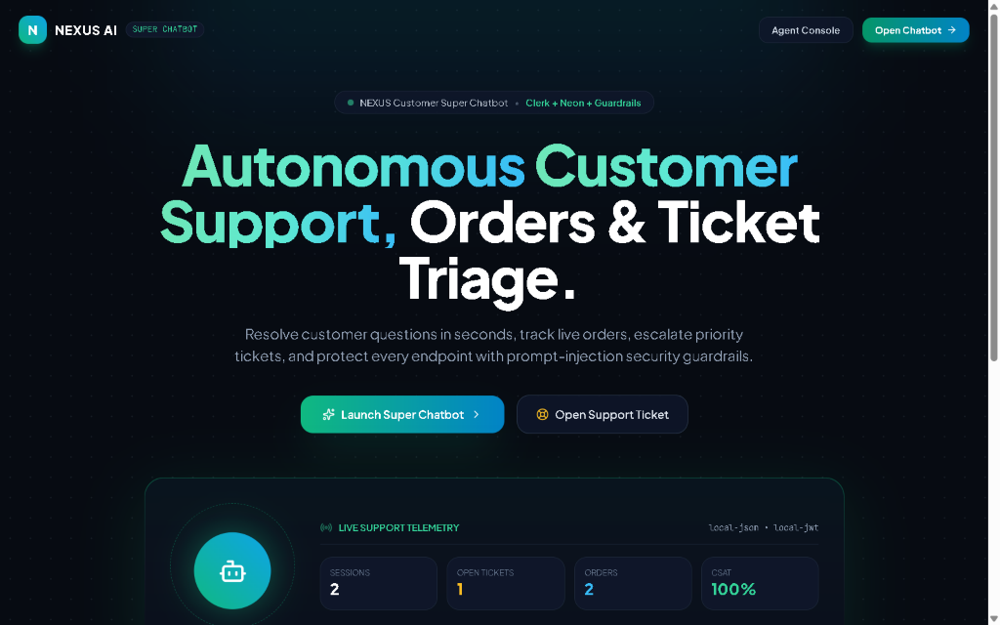
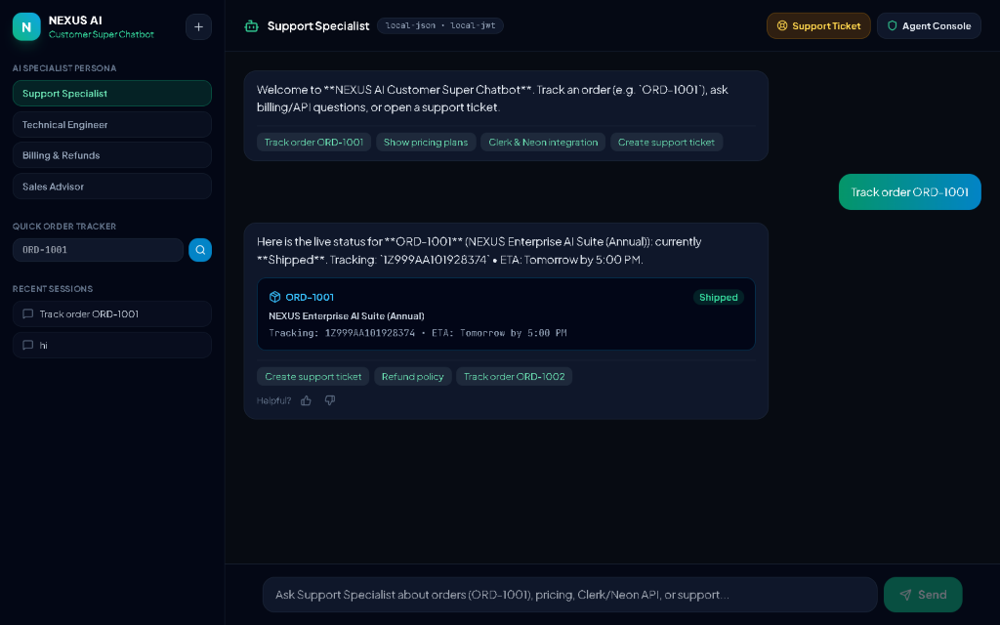
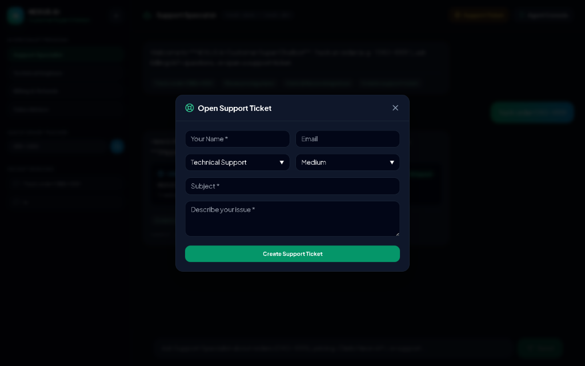
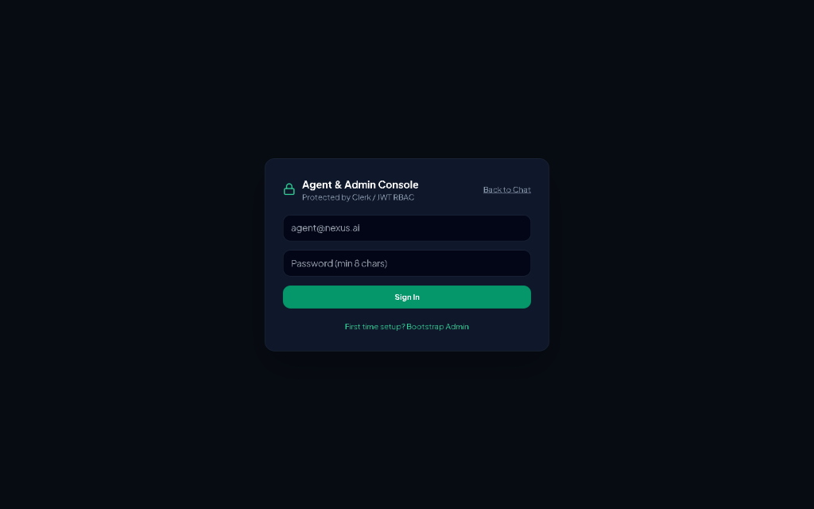
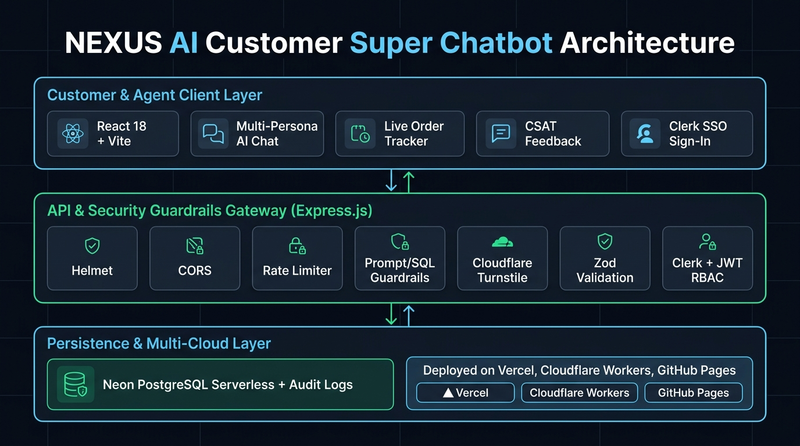

# NEXUS AI — Customer Super Chatbot

> **Enterprise AI customer support, order tracking, and ticket triage powered by Neon PostgreSQL, Clerk Auth, and Cloudflare Edge.**

[](https://nexus-ai-customer-super-chatbot.vercel.app)
[](https://github.com/kalyan870/nexus-ai-customer-super-chatbot/actions/workflows/ci.yml)
[](LICENSE)

NEXUS AI is a full-stack **AI Customer Super Chatbot** featuring multi-persona support (`Support Specialist`, `Technical Engineer`, `Billing & Refunds`, `Sales Advisor`), real-time order tracking cards (`ORD-1001`), CSAT feedback, autonomous ticket escalation, backend prompt/SQL security guardrails, and a Clerk/JWT RBAC Agent Triage Console.

**[Open the live application →](https://nexus-ai-customer-super-chatbot.vercel.app)** · **[Cloudflare Workers →](https://nexus-ai-customer-super-chatbot.saragadamkalyan068-fdc.workers.dev)** · **[GitHub Pages →](https://kalyan870.github.io/nexus-ai-customer-super-chatbot/)**

## Portfolio highlights

- Built a **3-zone SaaS Customer Super Chatbot** with switchable AI specialist personas, persistent conversation sessions, inline Order Tracking cards, and per-message CSAT ratings.
- Engineered **Backend Security Guardrails** (`backend/middleware/guardrails.js`) that block prompt injection, SQL injection, and `<script>` payloads, redact leaked secrets/tokens, attach `X-Request-Id` trace headers, and log `GUARDRAIL_BLOCKED` audit events.
- Implemented **Hybrid Clerk + JWT RBAC** (`admin`, `agent`, `customer`) with `scrypt` salted password hashing, `timingSafeEqual` verification, Zod input validation, Helmet headers, strict CORS, and **Cloudflare Turnstile** bot protection.
- Designed a **Neon PostgreSQL** relational schema (`users`, `conversations`, `messages`, `orders`, `tickets`, `knowledge_base`, `audit_logs`) with parameterized queries via `@neondatabase/serverless`.

## What it delivers

- **Multi-Persona Super Chatbot**: Switch between Support Specialist, Technical Engineer, Billing & Refunds, and Sales Advisor.
- **Real-Time Order Lookup**: Ask about or search order IDs (`ORD-1001`, `ORD-1002`) to render live shipping & tracking cards.
- **Support Ticket Escalation**: Log priority tickets (`TKT-...`) directly from chat or the ticket modal.
- **CSAT Feedback Loop**: Rate bot responses (`+1` / `-1`) to compute live CSAT scores in the Agent Console.
- **Agent Triage Console**: Clerk/JWT-protected workspace to triage and resolve open customer tickets.

## Live Output Screenshots

### Cinematic Landing & Live Support Telemetry (Anime.js v4)


### Super Chatbot & Live Order Tracking Card


### Support Ticket Creation Modal


### Agent & Admin Triage Console (Clerk / JWT Auth)


## Application Architecture

The application separates browser presentation, Express API & security guardrails, AI persona routing, and Neon PostgreSQL persistence.



## Backend Security Guardrails & RBAC

| Control | Implementation |
| --- | --- |
| **Prompt & SQL Injection Guardrails** | `securityGuardrails` inspects chat/ticket inputs, blocks injection patterns (`400`), attaches `X-Request-Id`, and logs `GUARDRAIL_BLOCKED`. |
| **Secret Redaction** | `redactSecrets` strips `scrypt$...`, `postgresql://...`, and Bearer JWTs from text outputs. |
| **Authentication & RBAC** | Hybrid `@clerk/backend` JWKS + local JWT + `scrypt` (`admin`, `agent`, `customer`). |
| **Bot & Payload Protection** | Optional Cloudflare Turnstile (`CF_TURNSTILE_SECRET`), Zod schema validation, XSS stripping, Helmet headers, rate limiting, and strict CORS. |

## Technology

| Layer | Technology |
| --- | --- |
| Frontend | React 18, Vite 6, Tailwind CSS, Lucide Icons, `@clerk/clerk-react` |
| API & Guardrails | Node.js, Express.js, Helmet, Zod, `jsonwebtoken`, `@clerk/backend` |
| Database | Neon PostgreSQL (`@neondatabase/serverless`) + Local JSON Adapter |
| Testing & CI | Node.js built-in test runner (`node --test`) — 8/8 Unit, Guardrail, Auth & E2E tests |
| Deployment | Vercel (Full-Stack), Cloudflare Workers, GitHub Pages |

## Repository structure

```text
backend/      Express API, Security Guardrails, Clerk/JWT RBAC, Neon DB adapter, unit & security tests
docs/         PRD, Design, Tasks, TechStack, Architecture, Database, API, User Flows, Acceptance & images
frontend/     React + Vite + Clerk Customer Super Chatbot & Agent Triage Console
vercel.json   Vercel Services configuration (frontend + backend)
wrangler.jsonc Cloudflare Workers static assets configuration
```

## Run locally

```powershell
cd backend && npm install && npm test
cd ../frontend && npm install && npm run build
cd .. && npm start
```
Visit `http://localhost:5001`.

## Environment variables

Never expose server secrets in the browser. Use [backend/.env.example](backend/.env.example):

```env
PORT=5001
NODE_ENV=development
DATABASE_URL=
CLERK_PUBLISHABLE_KEY=
CLERK_SECRET_KEY=
VITE_CLERK_PUBLISHABLE_KEY=
CF_TURNSTILE_SECRET=
JWT_SECRET=
JWT_EXPIRES_IN=8h
ALLOWED_ORIGINS=http://localhost:3001,http://localhost:5001
```

## Documentation

- [Product Requirements (PRD)](docs/PRD.md)
- [Design System](docs/DESIGN.md)
- [Implementation Tasks](docs/TASKS.md)
- [Technology Stack](docs/TECHSTACK.md)
- [Architecture](docs/ARCHITECTURE.md)
- [Database Schema](docs/DATABASE.md)
- [API Documentation](docs/API_DOCUMENTATION.md)
- [User Flows](docs/USER_FLOWS.md)
- [Acceptance Criteria](docs/ACCEPTANCE_CRITERIA.md)

## License

This project is available under the [MIT License](LICENSE).
